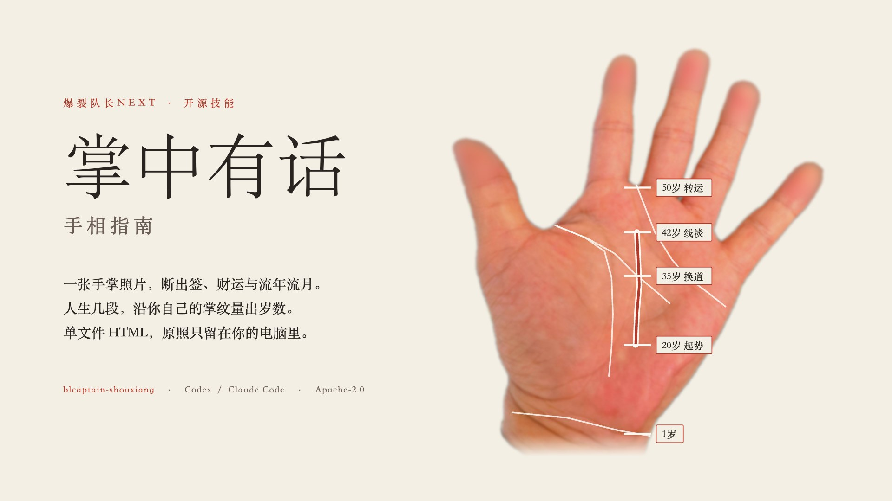
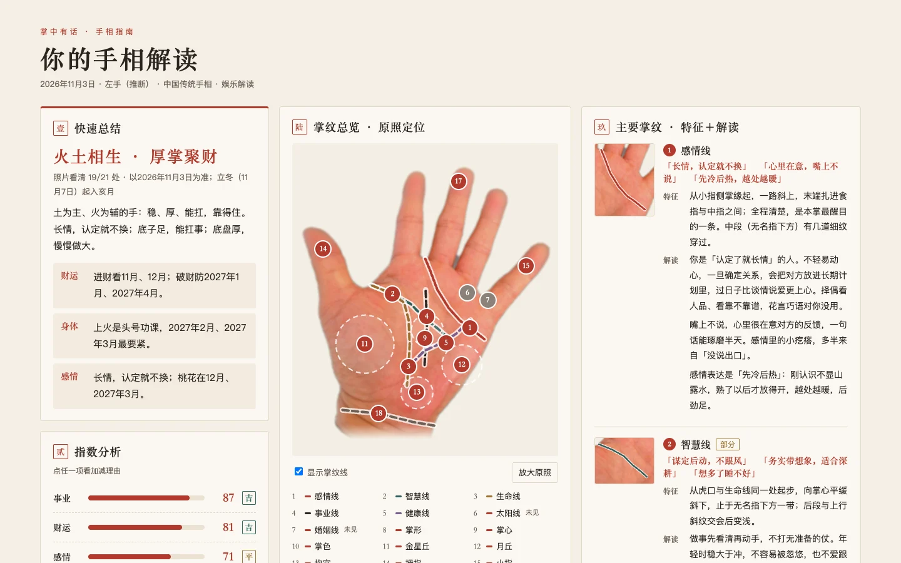
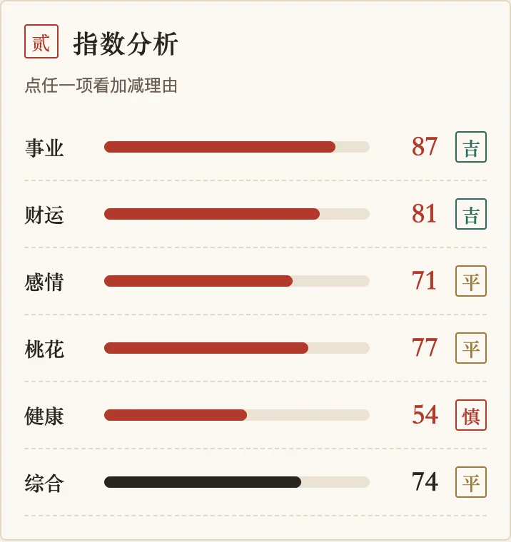
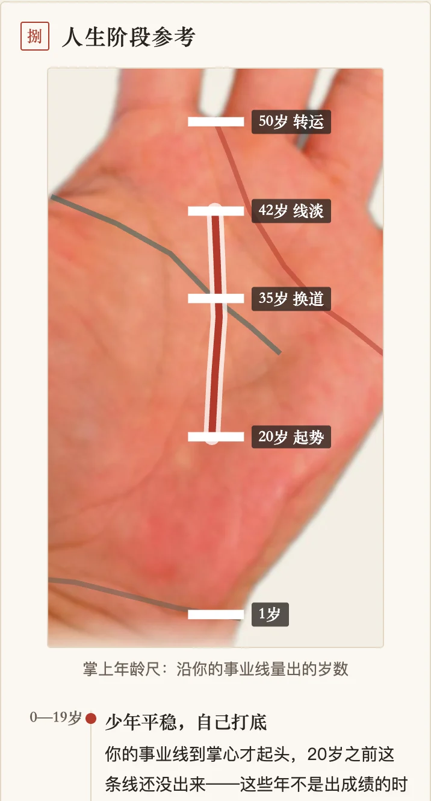

# Zhangzhong Youhua · Palm Reading Guide

[中文](README.md) · **English**

<div align="center">
  
</div>

[](LICENSE)  

> Send a palm photo to Codex or Claude Code and get back a palm reading written the way a fortune teller would say it to your face: the verdict first, the reasoning after.

`blcaptain-shouxiang` is BLCaptain's open-source palm reading skill. It works with any agent that can read `SKILL.md` and look at images, such as Codex and Claude Code. It is **for entertainment**: the wording is blunt, but it gives no medical diagnosis and no investment advice.

**Language note:** the generated report is in Simplified Chinese, and the command-line subcommands and flags are Chinese too (`指南`, `--输入`, …). This page explains the project in English.

*Zhangzhong Youhua* (掌中有话) means "your palm has something to say"; *shouxiang* (手相) is Chinese for palm reading.

---

## What you get

A single HTML file. The photo is embedded, it opens offline, and it reads well on a phone:

- **Quick summary:** a fortune slip, plus one line each on wealth, health and relationships.
- **Six indices:** career, wealth, relationships, romance, health and overall, each graded 吉 (good), 平 (fair) or 慎 (caution).
- **This year and the coming months:** which months bring money in, which months to guard against losses, when you are prone to "internal heat", and when romance shows up.
- **Life stages:** ages measured along your own career line, drawn as an age ruler on your photo, with the turning points marked: when things take off, when you change course, when your luck turns.
- **Line by line:** what was seen on each line, each finger, the palm mounts, palm color and fingertips, and which tradition reads it how.
- **Basis and method:** rule IDs, source tiers and the calculation method, all folded away at the bottom of the page and kept out of the main text.

<table>
  <tr>
    <td width="62%"></td>
    <td width="38%"></td>
  </tr>
  <tr>
    <td colspan="2" align="center"><sub>Sample report: desktop first screen and mobile index card. Open the <a href="examples/掌中有话-示例/掌中有话.html">full sample HTML</a> (download it and open it in a browser).</sub></td>
  </tr>
</table>

<div align="center">
  
  <br><sub>Life stages: wrist crease = age 1, crossing the head line = 35, crossing the heart line = 50, with the ages in between measured in proportion</sub>
</div>

The sample uses the author's own palm photo, **processed for privacy**: downscaled to 768×1024, all five fingertips blurred, the background replaced with a plain paper tone, and capture metadata removed. The original photo is not published.

---

## How it works

The scripts contain **no vision model**. The work is split like this:

1. **The host agent looks.** The agent studies your photo and, following the [observation contract](skills/blcaptain-shouxiang/references/指南观察契约.md), writes an observation record covering each line, palm shape, palm color, mounts, fingers, fingertips and wrist creases. Anything out of frame is written as 未见 (not seen) and anything unclear as 不清 (unclear). It never forces a reading of a line it cannot see.
2. **The script reads.** `palm.py 指南` takes the record and matches it against the 31 rules in the [reading library](skills/blcaptain-shouxiang/references/指南断语库.json), adjusting the indices. It then pairs the hand's Five Elements type with the solar-term months to lay out the year and the coming months.
3. **The page is built.** The output is `掌中有话.html`, `内容.json` and `回放.json`. The same record and the same date produce byte-identical output every time.

Every reading names one of four source tiers in the basis section:

| Tier | What it is |
|---|---|
| Classical | Original lines from *Shenxiang Quanbian* (神相全编) chapters such as "On the Hand", "The Three Governors" and "Lines of the Four Seasons", read from digitized texts |
| Modern | Line names and readings from 20th-century Chinese palmistry books, such as dating events along the career line |
| Folk | Common readings found on today's Chinese social platforms |
| Combined | This project's own method: the hand's Five Elements type set against the solar-term months. It is not presented as a classical method |

See [方法与边界](docs/方法与边界.md) (Method and limits, in Chinese).

---

## Install

Clone the repository:

```bash
git clone https://github.com/dososo/blcaptain-shouxiang.git
```

Copy the **whole** `skills/blcaptain-shouxiang` directory into your skills folder:

| Tool | Install location | Explicit call |
|---|---|---|
| Codex | `~/.agents/skills/blcaptain-shouxiang/` or `~/.codex/skills/blcaptain-shouxiang/` | `$blcaptain-shouxiang` plus your request |
| Claude Code | `~/.claude/skills/blcaptain-shouxiang/`, or `.claude/skills/blcaptain-shouxiang/` inside a project | `/blcaptain-shouxiang` plus your request |

Keep `scripts/`, `references/`, `agents/`, `assets/`, `LICENSE` and `NOTICE`. Restart or reload the tool and confirm it has found the skill; whether it triggers automatically is up to the host. To uninstall, remove the directory.

Requirements: Python 3.10 or later. With Pillow installed the photo can be a JPEG; without it, only PNG is accepted. No network access and no API key are needed.

Check that the files are intact (`诊断` means "diagnose"):

```bash
python3 ~/.claude/skills/blcaptain-shouxiang/scripts/palm.py 诊断
```

---

## Usage

Send your palm photo to the agent: palm up, fingers spread, natural light, ideally with the wrist creases in frame.

```text
Use $blcaptain-shouxiang to read this palm photo and tell me about my wealth this year.
```

The agent writes the observation record and then runs:

```bash
python3 "<skill dir>/scripts/palm.py" 指南 --输入 观察记录.json --原照 photo.jpg --输出 new-report-dir --问事 "今年财运"
```

The flags are `--输入` (observation record), `--原照` (original photo), `--输出` (output directory), `--问事` (your question) and `--日期` (date, `YYYY-MM-DD`).

The output directory must not exist yet, so earlier reports are never overwritten. Changing the question only reorders the quick summary, and changing `--日期` only changes the yearly and monthly forecast. Dates from 2025-01-01 to 2035-12-31 are supported, with solar-term dates taken from the Hong Kong Observatory. For any other date the script prints the supported range and stops.

To see it working first, generate a report from the sample record in this repository:

```bash
python3 skills/blcaptain-shouxiang/scripts/palm.py 指南 \
  --输入 examples/示例观察记录.json --原照 examples/示例手照.png \
  --输出 /tmp/palm-trial --日期 2026-11-03
```

---

## Limits and privacy

- **Just for fun.** Health notes are everyday reminders only (internal heat, sleep, digestion, sitting too long). They name no diseases and predict no dates. If you feel unwell for a long time, see a doctor.
- **No investment advice.** The wealth section only names months to hold on to money, watch for losses or expect income. It never says what to buy or whether to lend.
- **No scare tactics.** No "miss this and disaster strikes", no paid rituals to ward off bad luck.
- **Photos stay on your machine.** The photo, fingertip crops, your question and the observation record are your private data. The scripts never connect to the network or upload anything.
- **No identification.** Fingertips are recorded only as rough whorl, loop or arch candidates. No minutiae, full ridge patterns or identity templates are extracted.
- **Out of scope:** no PDF export, no social media covers or images, no automatic posting to any platform.

---

## Local checks

After changing the reading library or the scripts, run:

```bash
python3 skills/blcaptain-shouxiang/scripts/guide_checks.py
python3 skills/blcaptain-shouxiang/scripts/refresh_manifest.py
python3 skills/blcaptain-shouxiang/scripts/palm.py 诊断
```

`guide_checks.py` uses a synthetic record and the sample record to check data branches, index ranges, grades, the month tables, layout fields and replay consistency. Synthetic records only show that the program behaves as written; **they do not show the readings are accurate**. Readings from real photos need the person's consent and a human cross-check against the photo. So far this has been done for one hand only, the author's.

---

## About the author

**Zhangzhong Youhua · Palm Reading Guide** is created and maintained by **爆裂队长NEXT (BLCaptain)**.

- GitHub: [dososo](https://github.com/dososo)
- X / Twitter: [@thinkszyg](https://x.com/thinkszyg)
- Email: [blteam2026@outlook.com](mailto:blteam2026@outlook.com)

Feedback is welcome in [Issues](https://github.com/dososo/blcaptain-shouxiang/issues). Please do not post other people's palm photos there.

---

## License

- Skill entry, scripts, reading library and observation contract: Apache-2.0 ([LICENSE](LICENSE))
- Documentation (Chinese and English) and the sample observation record: CC BY 4.0 ([LICENSE-docs](LICENSE-docs))
- Images and the sample report that contain the author's palm photo (`examples/示例手照.png`, `examples/掌中有话-示例/`, `docs/media/`): all rights reserved by the author; they may only be distributed and displayed unchanged as part of this repository
- See [NOTICE](NOTICE) for how the licenses are split, and [第三方说明](docs/第三方说明.md) (Third-party notes, in Chinese) for classical sources and fonts

The sample palm photo is a privacy-processed version of the author's own hand, provided for demonstration only. It may not be reused on its own, or used for identification, biometric extraction or model training.
