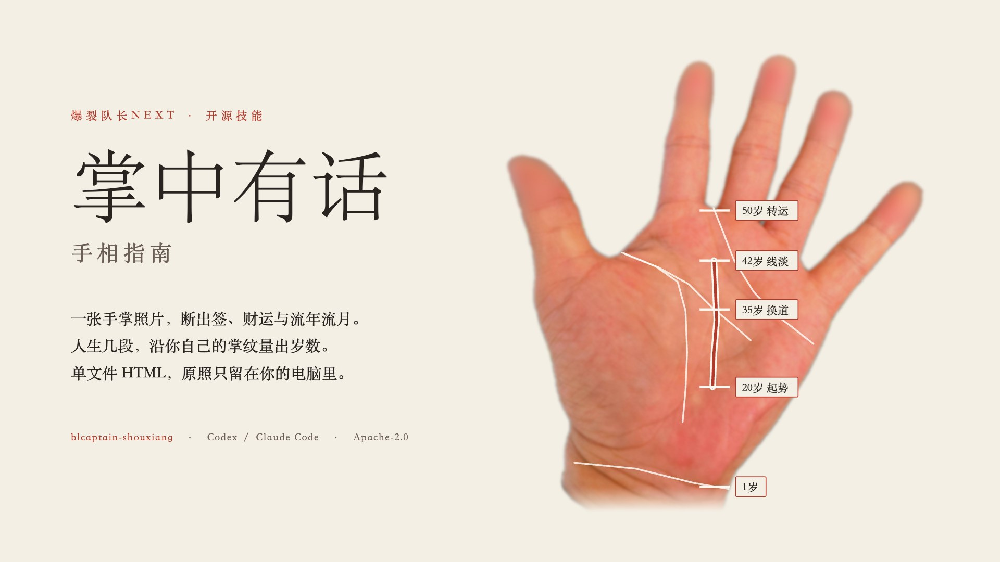
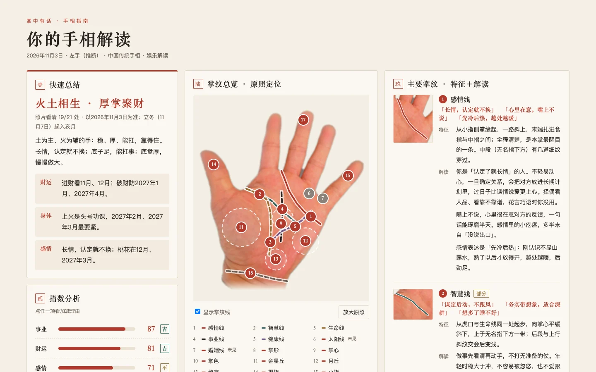
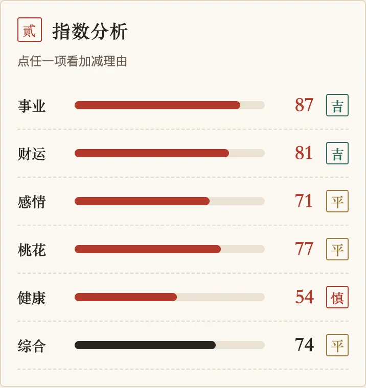
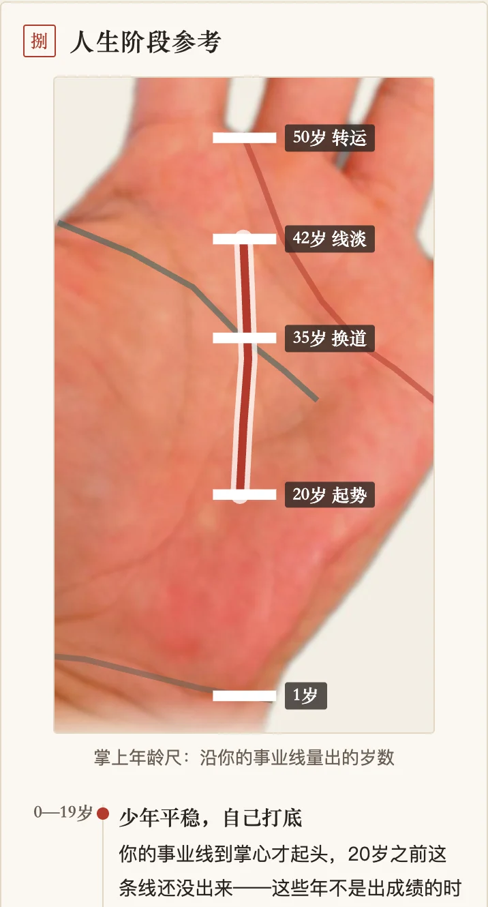

# 掌中有话 · 手相指南

**中文** · [English](README.en.md)

<div align="center">
  
</div>

[](LICENSE)  

> 发一张手掌照片给 Codex 或 Claude Code，拿回一份像算命先生当面讲给你听的手相指南：先给结论，再讲依据。

`blcaptain-shouxiang` 是爆裂队长的开源手相技能，适用于 Codex、Claude Code 等能读取 `SKILL.md` 并能看图的智能体。它是**娱乐向**的：话说得直白，但不做医学诊断，也不给投资建议。

---

## 它给你什么

一份单文件 HTML，原照内嵌，离线可开，手机上也能读：

- **快速总结**：一支签，加财运、身体、感情各一句。
- **六项指数**：事业、财运、感情、桃花、健康、综合，每项带「吉 / 平 / 慎」。
- **流年流月**：哪几个月进财、哪几个月防破财、哪几个月容易上火、桃花在哪几个月。
- **人生阶段**：沿你自己的事业线量出岁数，在原照上画出年龄尺，标出起势、换道、转运的转折点。
- **逐条掌纹**：每条纹、每根手指、掌丘、掌色、指腹看到了什么，按什么说法怎么断。
- **依据与方法**：规则编号、出处层级和推算方法，全部收在页底折叠里，正文不出现。

<table>
  <tr>
    <td width="62%"></td>
    <td width="38%"></td>
  </tr>
  <tr>
    <td colspan="2" align="center"><sub>示例报告：桌面首屏与手机指数卡。打开 <a href="examples/掌中有话-示例/掌中有话.html">完整示例 HTML</a>（下载后用浏览器打开）。</sub></td>
  </tr>
</table>

<div align="center">
  
  <br><sub>人生阶段：腕纹 1 岁、交智慧线 35 岁、交感情线 50 岁，中间按掌纹比例量出</sub>
</div>

示例用的是作者本人的手掌照片，**已做隐私处理**：降到 768×1024、五个指尖模糊、背景换成纯色纸底、去掉拍摄元数据。原照不随仓库公开。

---

## 怎么做到的

脚本**不内置视觉模型**。分工是这样的：

1. **宿主看图。** 智能体看你的原照，按 [观察契约](skills/blcaptain-shouxiang/references/指南观察契约.md) 逐处写一份观察记录：每条纹、掌形、掌色、掌丘、手指、指腹、腕纹。看不到写「未见」，看不清写「不清」，不硬认纹。
2. **脚本断语。** `palm.py 指南` 读观察记录，按 [断语库](skills/blcaptain-shouxiang/references/指南断语库.json) 的 31 条规则命中、加减指数，再用手型五行配节气月令排出流年流月。
3. **生成页面。** 输出 `掌中有话.html`、`内容.json` 和 `回放.json`。同一份记录、同一个日期，两次生成逐字节一致。

断语分四层来源，都在依据层标清：

| 层级 | 是什么 |
|---|---|
| 古籍 | 《神相全编》〈论手〉〈相三主〉〈四季纹〉等已读电子正文的原句 |
| 近代 | 近代通行手相书的命名与断法，如事业线流年 |
| 民间 | 当代平台上的通行说法 |
| 合参 | 本项目自己的玩法：手型五行配月令生克。不说成古法 |

详见 [方法与边界](docs/方法与边界.md)。

---

## 安装

先克隆仓库：

```bash
git clone https://github.com/dososo/blcaptain-shouxiang.git
```

把 `skills/blcaptain-shouxiang` **整个目录**复制到技能目录：

| 工具 | 安装目录 | 显式调用 |
|---|---|---|
| Codex | `~/.agents/skills/blcaptain-shouxiang/` 或 `~/.codex/skills/blcaptain-shouxiang/` | `$blcaptain-shouxiang` 加需求 |
| Claude Code | `~/.claude/skills/blcaptain-shouxiang/`，或项目内 `.claude/skills/blcaptain-shouxiang/` | `/blcaptain-shouxiang` 加需求 |

也可以从 [Releases](https://github.com/dososo/blcaptain-shouxiang/releases) 下载 `blcaptain-shouxiang-v2.0.1.zip`，解压得到的 `blcaptain-shouxiang/` 目录就是技能本身；同页附 SHA-256 校验和。

请保留 `scripts/`、`references/`、`agents/`、`assets/`、`LICENSE` 与 `NOTICE`。重启或重新加载工具，确认它实际发现了技能；自动触发由宿主决定。卸载时移走这个目录即可。

运行环境：Python 3.10 及以上。装了 Pillow 时原照可以是 JPEG，否则只收 PNG。不联网，不需要 API key。

先确认文件完整：

```bash
python3 ~/.claude/skills/blcaptain-shouxiang/scripts/palm.py 诊断
```

---

## 开始用

把手掌照片发给智能体，掌心朝上、五指张开、自然光，腕纹最好入镜：

```text
使用 $blcaptain-shouxiang 看这张手掌照片，帮我看看今年财运。
```

智能体会写观察记录，再运行：

```bash
python3 "技能目录/scripts/palm.py" 指南 --输入 观察记录.json --原照 原照.jpg --输出 新的报告目录 --问事 "今年财运"
```

输出目录必须是一个还不存在的新目录，旧报告不会被覆盖。换「问事」只改快速总结的先后顺序；换 `--日期` 只改流年流月。生成日期支持 2025-01-01 至 2035-12-31，节气日期取自香港天文台；超出范围时脚本会报出范围并停下。

想先看看效果，可以用仓库里的示例记录直接生成：

```bash
python3 skills/blcaptain-shouxiang/scripts/palm.py 指南 \
  --输入 examples/示例观察记录.json --原照 examples/示例手照.png \
  --输出 /tmp/掌中有话-试跑 --日期 2026-11-03
```

---

## 边界与隐私

- **图一乐。** 身体部分只给上火、睡眠、肠胃、久坐这类生活提醒，不写病名、不写发病日期；长期不适请去医院。
- **不给投资建议。** 财运只说守财、破财、进财月份，不说买什么、借不借。
- **不吓人。** 没有「错过就倒霉」，没有付费消灾。
- **照片只在本机。** 原照、指腹局部、问事和观察记录都是你的私人资产；脚本不联网、不上传。
- **不做身份识别。** 指腹只记粗略的斗、箕、弓候选，不提取细节点、完整嵴线或任何身份模板。
- **不做的事：** 不导出 PDF，不做社媒封面或配图，不自动发布到任何平台。

---

## 本地检查

改断语库或脚本后运行：

```bash
python3 skills/blcaptain-shouxiang/scripts/guide_checks.py
python3 skills/blcaptain-shouxiang/scripts/refresh_manifest.py
python3 skills/blcaptain-shouxiang/scripts/palm.py 诊断
```

`guide_checks.py` 用合成记录和示例记录检查数据分支、指数范围、档位、月份、版式字段与回放一致性。合成记录只能验证程序，**不能证明断得准**；真人照片的判读需要授权与人工对照，目前只做过作者本人一只手。

---

## 关于作者

**掌中有话 · 手相指南** 由 **爆裂队长NEXT（BLCaptain）** 创作与维护。

- GitHub：[dososo](https://github.com/dososo)
- X / Twitter：[@thinkszyg](https://x.com/thinkszyg)
- 邮箱：[blteam2026@outlook.com](mailto:blteam2026@outlook.com)

欢迎在 [Issues](https://github.com/dososo/blcaptain-shouxiang/issues) 提反馈。请不要在 Issue 里贴别人的手掌照片。

---

## License

- 技能入口、脚本、断语库与观察契约：Apache-2.0（[LICENSE](LICENSE)）
- 说明文档（中英文）与示例观察记录：CC BY 4.0（[LICENSE-docs](LICENSE-docs)）
- 含作者手照的图片与示例报告（`examples/示例手照.png`、`examples/掌中有话-示例/`、`docs/media/`）：作者保留全部权利，只允许随本仓库原样分发与展示
- 许可分工见 [NOTICE](NOTICE)，古籍出处与字体说明见 [第三方说明](docs/第三方说明.md)

示例手照是作者本人手掌的隐私处理版，仅作演示；不得单独再利用，不得用于身份识别、生物特征提取或模型训练。
